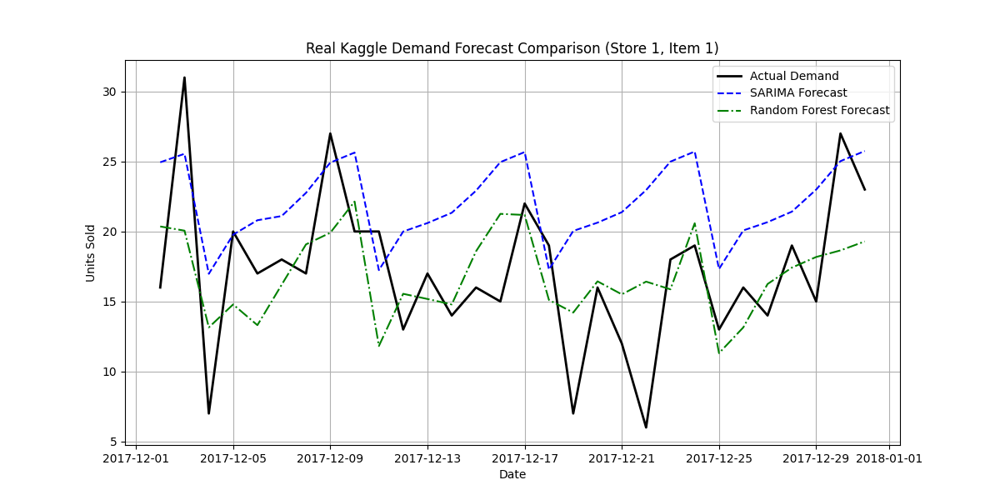
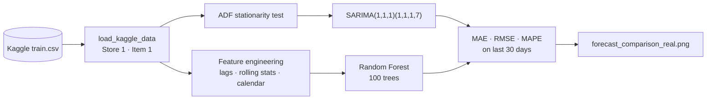

<div align="center">

# Retail Demand Forecasting: SARIMA vs Random Forest

**A modular time-series pipeline that pits a classical statistical model against a machine learning regressor on real Kaggle retail data.**


</div>

---

## Result

<div align="center">

<br>
<sub>Last 30 days of Store 1 / Item 1, held out. Black: actual. Blue dashed: SARIMA. Green: Random Forest.</sub>
</div>

<!-- Add your MAE / RMSE / MAPE from `python main.py` here:
| Model | MAE | RMSE | MAPE |
|---|---|---|---|
| SARIMA(1,1,1)(1,1,1,7) | | | |
| Random Forest (100 trees) | | | |
-->

### What the comparison showed

| | SARIMA | Random Forest |
|---|---|---|
| **Behaviour** | Consistently overpredicted demand through December 2017 | Tracked both the scale and the weekly rhythm of actual sales |
| **Why** | It leans on historical averages, so it projected the long-term upward trend forward and could not adapt to the lower actual volume of late 2017 | The 1-day lag and 7-day rolling mean let it react straight away to recent volumes, keeping predictions anchored to the real demand curve |

## Pipeline



## Key features

| | |
|---|---|
| **Modular architecture** | Business logic is separate from the runner. Adding a data source or model needs no change to `main.py`. |
| **Feature engineering** | Turns the series into a supervised learning problem for the Random Forest: 1, 7 and 30-day **lags**; 7-day **rolling** mean and standard deviation; **calendar** features (day of week, month, year, weekend flag). |
| **Strict temporal validation** | The split is a hard date cutoff (last 30 days held out), so there is no lookahead bias or leakage. |
| **Statistical diagnostics** | Augmented Dickey-Fuller test checks stationarity before the statistical model is fitted. |

## Project structure

```text
demand-forecasting-project/
│
├── .gitignore
├── requirements.txt
├── README.md
├── main.py                  # Project orchestrator
│
├── data/                    # Local storage for datasets (Git-ignored)
│   ├── train.csv
│   └── test.csv
│
└── src/                     # Core pipeline modules
    ├── __init__.py          # Marks src as a package
    ├── data_prep.py         # Data loading and feature engineering
    └── models.py            # Model definition and metrics calculation
```

## Run it

<details>
<summary><b>Setup and execution</b></summary>

<br>

Download `train.csv` from the [Kaggle Store Item Demand Forecasting Challenge](https://www.kaggle.com/c/demand-forecasting-kernels-only) into `data/`.

```bash
conda create --name demand_env python=3.10 -y
conda activate demand_env
pip install -r requirements.txt
python main.py
```

The script prints the ADF result and the metrics for both models, then saves `forecast_comparison_real.png`.

</details>

---

<div align="center">

**Pradyumna Shetty** · [LinkedIn](https://www.linkedin.com/in/pradyumna-shetty-534a14132/) · [Portfolio](https://portfolio-gamma-teal-22.vercel.app)

</div>
